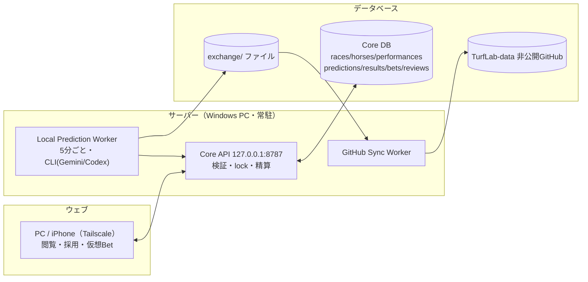
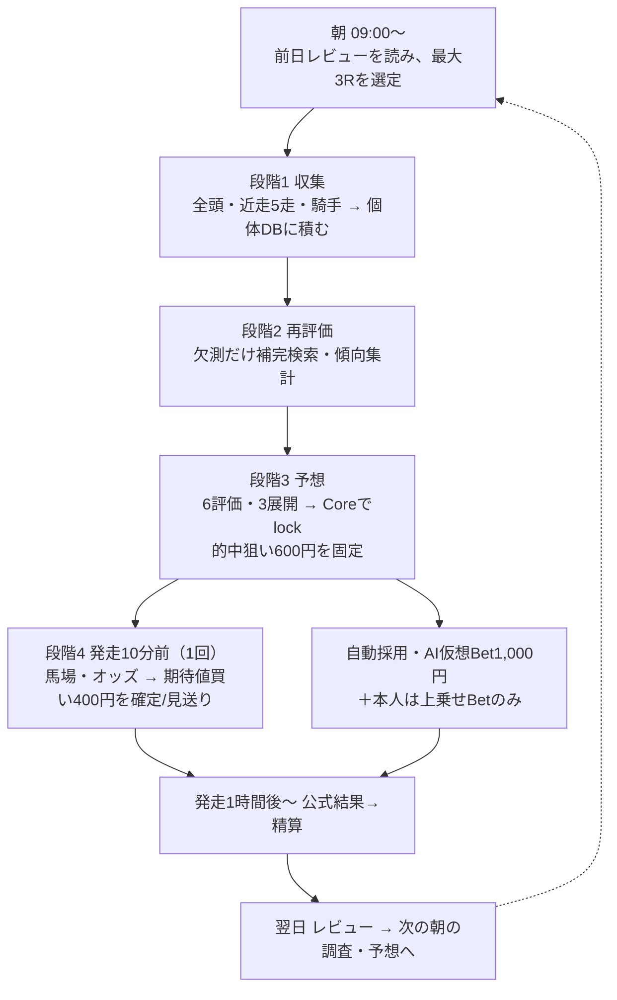

# TurfLab

競馬のレースを、**AIの予想（採用参考）** と **本人の仮想購入** に分けて記録し、結果と照合して精度と収支を別々に検証する個人用ポータル。実馬券の購入・資金移動は行わない。

> 1日の動きの正本は **[docs/daily-flow.md](docs/daily-flow.md)**。図解とプロンプト全文は [system-guide](docs/system-guide.md)、履歴は [status-log](docs/status-log.md)。

## 全体像：サーバー・データベース・ウェブ



## 1日の流れ（要約）



| 時間帯 | 動き |
|---|---|
| 常時（5分ごと） | CSV取込・統計・結果確認の対象探索 |
| 08:00〜 | 日次状態を `TurfLab-data/state/` へ追記（15分ごと） |
| 09:00〜21:00 | 3時間枠で最大3Rを選定し、収集→補完→予想 |
| 発走10分前 | 馬場・オッズ確認、期待値買い400円を確定 or 見送り（1回のみ） |
| 取り込み直後〜発走前 | **自動**：locked読返し→採用版固定→AI仮想Bet（1R1,000円）。本人は上乗せBetだけ（上限なし・出資金10万円の残高内） |
| 発走1時間後〜 | 公式結果・払戻 → 精算 → 比較 |
| 翌日 | レビューが翌日のプロンプトに入る |

## 運用の約束

- **AIは候補を出すだけ**。総合点・順位・確率・精算はコードが決め、Coreが `locked` で読み返せて初めて正式予想になる。
- 自動選定は**最大3R/日**（調査コストのため）。条件不足の日は見送りも可。
- 予想時点・出典・モデル版を固定。再予想は別ID。オッズ・人気は能力評価に使わない（期待値買いの計算のみ）。
- **予想の取り込みは完全自動**（検証→lock→採用→AI仮想Bet）。本人の操作は「上乗せBet」だけで、1R・1日の上限はなく、出資金10万円はAIと本人で**1つを共有**する。AIは残高が足りなければ縮めず見送り、本人も残高内でのみ上乗せできる。
- AIの採用参考収支と本人Bet収支は混ぜない。本人Betの内容はAIに渡さない。
- 公式結果・全払戻を確認して精算。暫定結果は収支に入れず、訂正は履歴と差額で残す。
- 重みは自動で変えない。未使用30R以上の検証と本人承認が必要。
- 補助経路として、ChatGPT朝9時タスク＋GitHub Bridgeも残る（[日次運用フロー](docs/daily-operation-flow.md)）。

## 起動

Node.js 22以上。

**Windowsではリポジトリ直下の `Start-TurfLab.bat` をダブルクリック**すると、初回セットアップ（必要時のみ）→ローカルWeb/API起動→Tailscale Serve HTTPS 8443→疎通確認→PCブラウザ表示までまとめて行う。Tailscaleは事前にWindowsとiPhoneで同じtailnetにログインする。二重起動を避け、既存の仮想Betデータを保持する。Tailscaleが未設定でもローカルは起動し、未接続を明示する。実URLは起動時のコンソールで確認。詳細は[Windowsクイックスタート](docs/windows-tailscale-quickstart.md)。

Windows実運用は [Windows / Tailscale / iPhone手順](docs/windows-tailscale-quickstart.md) を参照。`scripts/windows/Initialize.ps1` → `Start.ps1` でビルド済みWeb/APIを127.0.0.1:8787に起動し、固定DataHomeへ保存する。Tailscale Serveの共有は別操作。

```bash
npm ci
npm run check
npm run dev:api
npm run dev
```

`workers/api/.dev.vars` に24文字以上のランダムな `API_TOKEN` を設定し、Webの本人用接続キーへ入力する。初期設定はローカル保存。本番Sheets接続・受信タブ・バックアップは [運用手順](docs/operations.md) を参照する。認証情報、SheetsのID、実データはGitへ含めない。

## 実装と資料

| 場所                | 内容                                             |
| ------------------- | ------------------------------------------------ |
| apps/web            | PC・スマホのポータル                             |
| workers/api         | 認証、直列化、永続ジャーナル、Sheets、業務API    |
| packages/shared     | データ型、29テーブル、正規化・検証・バックアップ |
| packages/simulation | seed付き区間Monte Carlo                          |
| database/sheets     | JSON Schema・旧タブ列対応                        |
| database/d1         | 移行検証用SQL（本番切替は未実施）                |
| tests / scripts     | テスト、コード生成、負荷・ブラウザ確認           |

[システム設計](docs/architecture-v0.2.md) · [機能要件](docs/requirements.md) · [論理DB](docs/data-model.md) · [JSON仕様](docs/chatgpt-import.md) · [架空JSON](docs/examples/chatgpt-import-v0.2.json) · [ロードマップ](docs/roadmap.md) · [数値モデル仮説](docs/simulation-model.md) · [D1移行計画](docs/d1-migration.md)。設計時の未実装記述より最新の実装状況・運用手順を参照する。

コミットは `feat: 予想取り込みを実装` のように接頭辞付き・日本語とする。


日次の参照分析記録と前日Coreデータの自動引継ぎは [日次運用フロー](docs/daily-operation-flow.md) を参照。Windows Workerが稼働中の場合、08:00 JST以降にread-onlyの日次スナップショットを非公開データrepoへ出力する。朝9時タスクによる参考分析のGitHub保存は接続権限次第であり、定時書込は未実証。
