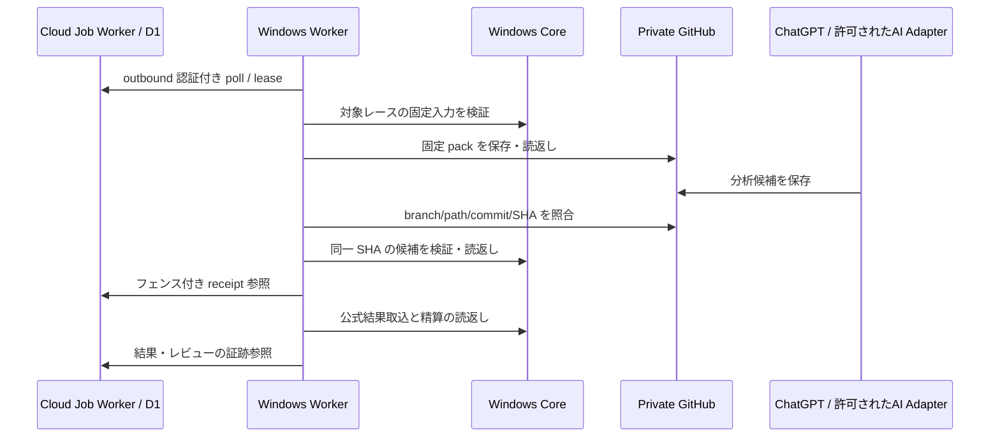

# ADR 0002 — Cloud Job Orchestrator と Windows Core

2026-11-08。採用方針は C2。第1段階は状態遷移、読取診断、AI Provider の契約を実装する。Cloudflare の永続化・連携は後続。

## 背景と監査

- 親 [#41](https://github.com/Soso2e/TurfLab/issues/41) の許諾済み根拠、無人 GitHub 書込、実1R・結果精算は受入待ち。[#36](https://github.com/Soso2e/TurfLab/issues/36) と [#39](https://github.com/Soso2e/TurfLab/issues/39) の本番受入、[#55](https://github.com/Soso2e/TurfLab/issues/55) の検証仮説も独立に扱う。基準は `origin/main` の `520abbd`。
- [名前登録](../name-only-reference-intake.md) は公式ID未照合の参考入力を扱う。既存 Wizard、固定 pack、[Prediction Bridge](../github-prediction-bridge.md)、[Result Bridge](../github-result-bridge.md)、Core を再利用する。Worker は GitHub を読んで Core の locked と結果IDを読み返し、ローカルに receipt を保持する。
- 非公開データ repo の確認時の root は `catalog/`、`daily/`、`packs/`、`reviews/`、`state/`。`predictions/` と `results/` は既存の版付き保存契約に従う。GitHub の `state/` は生成時点を伴うスナップショット。11/7 08:00 JST の v1 が locked/公式結果 0 件でも、当日全体の件数はそこから確定できない。
- [日次運用](../daily-operation-flow.md) の ChatGPT 定時枠は JST 09:00 / 10:00 / 12:00。トリガー種別・予定枠・実際の開始時刻を別フィールドで記録する。11/7 の 11:58:36 開始だけでは、12:00 枠か手動点検かを判別できない。

## 責務と正本

| 担当 | 保持・判断 |
| --- | --- |
| Cloud Job Orchestrator | JST 日付、race key、kind、phase、run ID、試行、lease、heartbeat、期限、エラー、SHA・receipt 参照。依存関係、再試行、稼働監視、通知の重複防止。 |
| ChatGPT / Windows AI Adapter | 既存定時タスクと、将来許可されたジョブの分析候補。候補は未検証入力として扱う。既定は既存 ChatGPT 受渡し。CLI は本人が許可したジョブと Provider に限定する。 |
| GitHub Bridge | 非公開の追記専用ファイル。新規保存後は branch・path・commit・Blob SHA・内容 SHA-256 の読返しを将来の C2 receipt に必須とする。同じ path の別内容は停止し、新しい版へ進む。 |
| Windows Worker / Core | 入力・個体照合・固定 pack/hash・全馬6評価・3展開・予算・locked・公式結果と精算。本人の仮想 Bet は独立操作。結果の出典本文を独立照合した証明と、現行 Core が取込条件を検証して保存した証跡は別々に扱う。 |
| React Web / Windows CLI | 既存認証付き Web を継続。第1段階は OS のファイル権限で保護されたローカル CLI で、レース別に Worker の観測範囲を表示。将来の Web も既存本人認証を通す。 |

Cloud には業務ペイロードや本人 Bet を送らず、参照と処理メタデータだけを保持する。GitHub にはトークン、無許諾の資料本文、本人 Bet の新規交換データを送らない。既存 `state/` の契約と公開範囲は今回の変更対象外。予想対象は1日5R、1R上限1,000円・日5,000円。オッズと人気を予想根拠に使わず、[外部予想根拠監査](../external-forecast-audit.md) の cutoff・許諾・欠測ルールを維持する。

## 将来の処理順

## ジョブ状態と復旧

- 一意キーは `JST日/raceKey/morning`。固定 pack は snapshot ID・pack hash・cutoff を保持する。採用した GitHub receipt は SHA を固定し、旧時点を遡及変更しない。
- `DISCOVERED → INPUT_READY → WAITING_AI → AI_SAVED → VALIDATING → CORE_LOCKED → WAITING_RESULT → RESULT_VERIFIED → REVIEWED`。結果のみ存在するレースも診断の結果欄で独立に表示する。実装の reducer は Morning ジョブの履歴を扱い、Core の状態値や結果改訂を置き換えない。
- DB 保存の実装時は一意キーと revision の compare-and-swap を同じ操作で適用する。lease は最大120秒、所有者・run ID・fence と期限を検証し、古い heartbeat や完了を拒否する。時刻は Cloud の受付時点を使い、過去の実行時刻は証跡フィールドとして扱う。二重実行や通信断を防ぐには、外部 I/O の immutable キーと readback も必要。
- `401/403` は `BLOCKED` として停止・通知対象。429/timeout は15秒から指数 backoff、0〜5秒の jitter、各段階最大5試行。AI 保存の成否が不明なら `AI_UNCONFIRMED` で停止し、未生成の確認後にだけ再試行を許可する。保存済みなら同じ SHA を照合・復旧する。JSON/schema 不正・版衝突は手動確認、新規版の対象。
- PC 停止は `WAITING_LOCAL`。起動後は同じ SHA と pack を照合する。発走後は新規 Morning を作成せず、発走前に確定した Core receipt の照合だけ許す。結果・レビューは別工程で進める。Cloud 障害時は既存のローカル運用を継続し、回復後に確定証跡を突合する。
- 現行 Bridge の state は観測した Blob とローカル状態を保持する。全件の commit や保存時刻、型付き HTTP ステータスは揃っていない。第1段階の診断は現存する証跡を投影し、C2 の完全な receipt を生成しない。Bridge の書込後読返し強化は永続化・連携の段階で扱う。

## Cloudflare の選定と費用

既存 Wrangler には `COORDINATOR`（SQLite Durable Object）、静的アセット、無効化済みの業務自動処理設定がある。C2 用 D1 / Workflows binding は未構成。後続では別の Worker にジョブメタデータ専用 D1 binding を置き、CAS・日付/期限索引・監査イベントを小さく検証する。運用環境で binding の実在、Free プラン、クォータ、ドメイン、認証経路を確認してから本番接続を判断する。

- D1 Free は日次 500万行読取・10万行書込、合計5GB。日次上限を超えるとクエリが失敗する。たとえば1台が60秒ごとに poll して heartbeat 1行を更新する場合、1,440 リクエスト・1,440 行書込/日が基本で、索引・イベント・他のアプリの利用量は別に計測する。[D1 料金](https://developers.cloudflare.com/d1/platform/pricing/) · [Workers 制限](https://developers.cloudflare.com/workers/platform/limits/)
- Workflows は複数の長い待機や承認工程が必要になった時に再評価する。Free 枠には日次ステップ上限と保存上限があり、Paid ではリクエスト・CPU・ステップ・保存が課金対象になる。自動アップグレードは前提にしない。[Workflows 料金](https://developers.cloudflare.com/workflows/reference/pricing/)
- Windows からは TLS の outbound のみ。Cloud 側を Access の Service Auth で保護し、ジョブ専用 ID に claim/report の権限を限定する。Cloud 側は認証済み機器と lease 所有者の対応を検証する。ローカル Core の本人キーと分離し、資格情報の保管・失効・ローテーションを受入に含める。[Access Service Token](https://developers.cloudflare.com/cloudflare-one/access-controls/service-credentials/service-tokens/)
- Windows のみの方式は電源断中に監視が止まる。業務 DB の全面クラウド移行は移行と復旧の影響が大きい。既存 Core の DO を Cloud ジョブにも共用すると障害・配備の範囲が広がる。C2 は監視と業務保存を分離した構成で進める。

## 次の実装順と受入

1. Cloud メタデータ永続化、認証、outbound poll、commit/内容ハッシュの読返しと通知の重複防止を隔離環境で検証。
2. Codex を最初の Windows CLI 受入候補とし、明示許可・非対話認証・利用条件・構造化 stdout・終了コード・stderr の秘匿・課金を検証。Claude / Antigravity は別に判定する。複数同時実行や自動切替は無効。
3. 実 ChatGPT 定時タスクが隔離 private branch に新規保存できることを commit と SHA で読返し、予定枠と手動実行を区別。
4. 許諾済みの実レース1Rで、発走前入力・AI 保存・Windows Core locked の読返しを受入。
5. 完全な公式結果・払戻と訂正版を検証し、既存の本人仮想 Bet 精算まで読返し。
6. 実 Windows の再起動・PC 停止・ネット断、Cloud 側の失効・競合・復旧を検証。第1段階では純粋関数と隔離テストまで。
