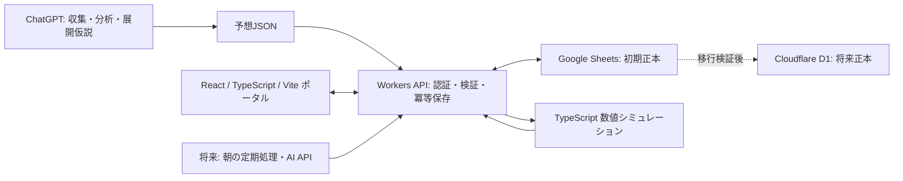

# TurfLab システム設計 v0.2

登録日: 2026-10-12（日本時間）。元の「競馬予想ポータル構築」のv0.1/v0.2会話を整理した実装用の設計基準です。

## 1. 目的と境界

競馬場・馬・騎手・過去戦績・当日の馬場・枠順・位置取りを組み合わせ、展開の仮説と確率予測を保存して検証します。的中を保証する仕組みではなく、どの条件で予測が成功・失敗したかを追跡する個人用研究基盤です。

ChatGPTで分析 → JSONの検証・保存 → Webで内容確認 → 本人が仮想購入 → 翌朝に結果照合、を最初の完成目標とします。Notionを必須処理へ含めません。

## 2. 全体構成

初期版は本人用認証と手動JSON取り込み。OAuthまたは個人用認証の具体方式はPhase 1で決めます。WebからSheetsの認証情報を扱わず、Workers側の接続境界に置きます。自動化はPhase 6で明示的なスケジューラ・AI APIを導入します。UI補助としてTailwind CSSを検討します。

## 3. 責務

| 層 | 責務 |
|---|---|
| ChatGPT | 情報収集、出典整理、能力・適性推定、ペース仮説、事後レビュー |
| API | 認証、形式・参照・時点検証、予算チェック、保存と読み返し、実行状態 |
| Repository | Sheetsの行配置を隠蔽し、将来D1へ置換できるデータアクセス |
| Simulation | 記録された入力・モデル・seedで実際に数値試行し、分布を集計 |
| Portal | 更新時刻・不足情報・根拠・予想版・予算・失敗状態を本人に提示 |

## 4. 予想時点と版

予想には `information_cutoff_at`、入力ハッシュ、参照したスナップショット・特徴量版、モデル版を固定します。データの観測時刻だけでなく、利用可能時刻とシステム取得時刻も締切以前である必要があります。後日公表された過去成績を当時入手済みのように使いません。

MorningとFinalは別予想。採用版は発走前に確定済みのFinal、なければMorningという事前規則で選び、発走前に固定します。発走後の再分析はreview/backtestとして記録し、当日の成績を良くする差し替えには使いません。取消・馬場更新時の再予想も別IDにします。

## 5. コース・馬・騎手

競馬場名だけで適性を判定せず、競馬場×芝/ダート/障害×距離×内外回り×使用コースを識別します。直線長、坂の位置・勾配、コーナー、スタートから最初のコーナーまでの距離を出典付きで管理します。実際の数値は公式情報を確認してから取り込み、欠測は0で埋めません。

馬のマスターと当日の状態を分離し、過去戦績は着順だけでなくタイム、上がり、通過順位、枠、斤量、馬体重、不利を扱います。得意距離・脚質・持久力などは推定として評価日、標本数、信頼度を保存します。騎手の戦術傾向は騎乗馬の能力・脚質を考慮し、先行馬への騎乗が多いことを騎手固有の好みと断定しません。

## 6. シミュレーション

全対象レースに展開シミュレーションを必須とします。Phase 5以前はChatGPTのシナリオ分析を `narrative` として保存し、数値試行済みとは表示しません。

数値エンジンはスタート → 序盤 → 中盤 → コーナー → 最終直線 → ゴール前をモデル化。スロー/平均/ハイペースのシナリオ重み、出遅れ、位置取り、距離損失、疲労、加速の揺らぎを入力とします。初期の試行数案は10,000回ですが、精度・実行時間を検証して決めます。試行数だけで予測の妥当性を判断しません。

エンジン版、入力ハッシュ、seed、試行数、完了状態、勝率・複勝圏確率・組合せ確率を保存。同seed・入力・版で再現できることを検証します。確率から買い目を作る際は予想時点のオッズを使い、最終オッズで過去の推奨を改変しません。

初期評価ウェイトは近走25%、コース距離15%、展開脚質15%、馬場15%、枠位置10%、騎手10%、調教5%、コンディション5%。未検証の比較基準であり、距離適性と持久力などの二重加点を検証します。プロンプト、モデル提供元・識別子、能力推定の規則、特徴量とエンジンの版も保存します。

## 7. 保存・復旧

1レース単位で Race → Entries → Snapshot → Prediction → Evaluations → Simulation → Recommendations → 件数・ハッシュ読み返し → complete と進めます。購入は本人の独立操作です。予想完了時の購入0件は正常であり、購入確定操作後の0件はエラーです。

SheetsにはDBのトランザクションや一意制約がないため、APIを唯一の書き込み入口として直列化し、操作ID・書き込み予定・各段階のチェックポイントを記録します。部分保存は公開せず、同じ操作IDの再試行で欠けた行を補います。同じIDで内容が異なる場合は競合として停止。予算の同時確定も直列化と再読込で防ぎます。具体的なロックの永続化・障害復旧方式はPhase 1で決定・検証します。

個人がSheetsを直接編集した場合の差異は整合性監査で検出します。原則は追記、確定データの修正は訂正版を追加。D1移行時は件数、ID、参照、ハッシュ、集計値を照合し、正本を一度だけ切り替えます。恒常的な二重正本は作りません。

## 8. 毎朝と検証

日本時間9時までの閲覧を将来の運用目標とします。前日結果・払戻 → 精算 → レビュー → 当日選定 → 情報固定 → 全件分析・シミュレーション → 保存・読み返し → 表示。失敗したレースだけ再開し、取得不足・取消・開催なしは見送り理由を表示します。朝の自動処理から購入を確定しません。

全採用予想と本人の仮想購入の母集団を分離。競馬場、距離、脚質、馬場、騎手、モデル別に標本数付きで比較し、確率校正、Brier Score、Log Lossも扱います。観測 → 仮説 → 未使用期間で検証 → 新モデル採用の順で改善。バックテストは時間順分割と当時利用可能なデータのみで実施します。

## 9. 配置案・未確定事項

実装時は `apps/web/`、`workers/api/`、`packages/shared/`、`packages/simulation/`、`database/sheets/`、`prompts/` を使う案です。現段階では空のアプリや実行コードを作りません。

データ提供元と利用条件、既存Sheetsの列・権限、OAuth方式、API費用上限、朝の起動時間、Workersでの数値計算負荷、バックアップ保管先は各Phaseで確認します。古い添付候補3ファイルはこの環境に存在せず、そのSQLを検証済みとして引き継いではいません。今回の[論理DB設計](data-model.md)をPhase 1の基準とし、実際のSheetsに合わせた列・移行対応を確定します。

Phase番号は今回の依頼に合わせた[ロードマップ](roadmap.md)を正とします。
