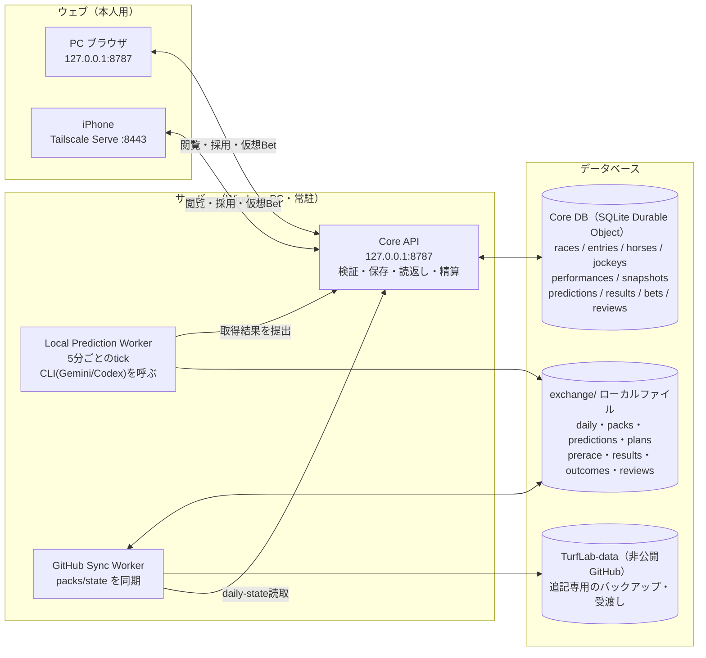
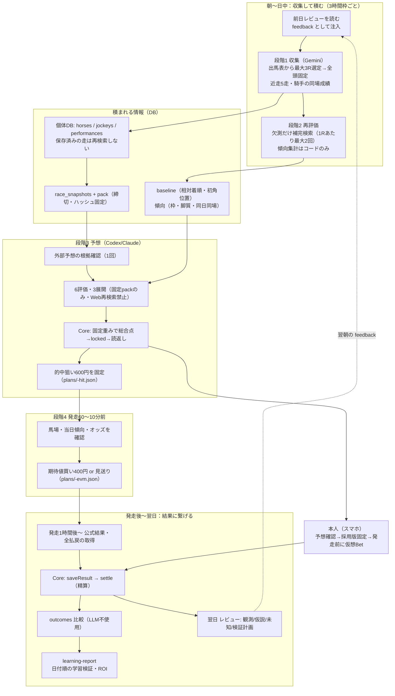
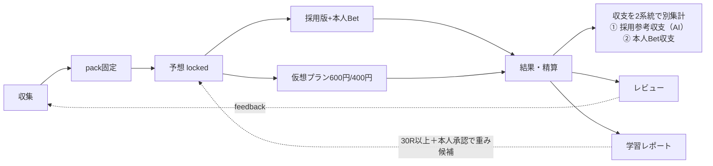

# TurfLab 1日のフロー（現行・正本）

2026-11-23 整理。**1日の動きはこの文書を正とする。** 他の文書と食い違う場合はここを優先する（食い違いの経緯は [status-log.md](status-log.md)）。実装との対応は `scripts/local-prediction-worker.ts` と [race-flow-v2.md](race-flow-v2.md)。

## 0. 前提（決定済みの方針）

| 項目 | 現行 |
|---|---|
| 主力経路 | **ローカルCLI自動運用**（2026-11-08〜）。サーバー（Windows PC）が稼働している間、5分ごとに1周する |
| 自動選定レース数 | **最大3R/日**（`MAX_AUTO_RACES = 3`。2026-11-11に5Rから変更。調査の呼出しが増えるため） |
| 1周で進む量 | 1レースにつき**1段階だけ**。CLIを呼んだ周期はそこで止め、次の周期（5分後）に回す |
| 予算（仮想） | 1R合計1,000円＝**的中狙い600円**（オッズ不使用）＋**期待値買い400円**（発走前オッズ）。本人Betは別（1R1,000円・JST1日5,000円） |
| AIの役割 | 事実収集・評価・展開仮説。**総合点・順位・確率・精算はコード側**が決める |
| 補助経路 | ChatGPT朝9時タスク＋GitHub Bridge（[daily-operation-flow.md](daily-operation-flow.md)）。主力ではなく補助。ここだけ「1日最大5R」の記述が残るが、自動選定の上限とは別物 |

## 1. 3つの役割：サーバー・データベース・ウェブ

- **サーバー**：判断はAI、保存と検証はCore API。AIの出力は「未検証の候補」で、Coreが締切・ハッシュ・全頭網羅を検問し、`locked` で読み返せて初めて正式予想になる。
- **データベース**：Core DBが正本。`exchange/` はローカルの不変（追記）ファイル、`TurfLab-data` はその非公開コピー。Google Sheetsは旧記録の読取専用（現行の保存先ではない）。
- **ウェブ**：閲覧・採用版の固定・仮想Betの登録/訂正だけを行う。AIには本人Betを渡さない（分離）。

## 2. 1日の流れ（情報がどう積み上がるか）

### 時間軸

| 時間帯 | 動き | 主な保存先 |
|---|---|---|
| 常時（5分ごと） | NAR CSV取込、統計digest、結果確認の対象探索 | `nar-csv/`、stats、`status.json` |
| 08:00〜 | GitHub Workerが日次状態を15分ごとに調べ、変化があれば追記 | `state/日付/daily-vN.json`（最大24版/日） |
| 09:00〜21:00（3時間枠） | 前日レビューを読み、最大3Rを選定→全頭・近走5走・騎手を収集 | `daily/`、個体DB |
| 午前〜（段階2） | 欠測項目だけ補完検索。傾向集計は常にコード | 個体DB、`research.local_stats` |
| 〜発走前（段階3） | pack固定→外部予想確認→予想→lock→的中狙い600円を固定 | `packs/`、`predictions/`、`plans/-hit.json` |
| 発走3時間前〜 | 馬場が未発表なら公式の馬場だけ再確認（競馬場ごと2時間枠で1回）。新しい馬場なら新packで再予想 | 新pack |
| 発走60〜10分前（段階4） | 馬場・当日傾向・オッズを確認し、期待値買い400円または見送りを固定 | `prerace/`、`plans/-evm.json` |
| 発走前 | 本人が採用版を固定し、仮想Betを登録・訂正 | Core（採用・bet） |
| 発走1時間後〜 | 公式結果・払戻を確認→保存→精算→outcomes比較 | `results/`、Core、`outcomes/` |
| 翌日 | レビュー作成。以降の調査と予想のプロンプトに仮説として注入 | `reviews/`、Core `reviews` |

呼出し上限（1日）：調査（Gemini）24回、予想（Codex/Claude）6回、結果・レビュー10回。枠ごとに独立し、どれかが尽きても他は止まらない。

## 3. AIを使う処理と、コードだけで動く処理

「AIの呼出しを減らして安くしたい」ときの現状地図。

| 区分 | 処理 | 備考 |
|---|---|---|
| **AI（CLI）** | 出馬表・近走・騎手の調査 | 保存済みの走は依頼から外す。全頭そろえばCLIを呼ばない |
| | 欠測の補完検索、馬場・オッズ確認、外部予想の根拠確認 | 1Rあたり最大2回の補完 |
| | 6評価・3展開の予想（段階3） | 最も高コスト。予想枠6回/日 |
| | 公式結果の確認、翌日レビュー | 結果・レビュー枠10回/日 |
| **コードのみ（AI不使用）** | NAR CSV取込・統計digest・枠/騎手の集計 | CSVは本人が手動保存（下記の注意） |
| | baseline、傾向集計、根拠の充足判定（observed/weak/missing） | `evidence-coverage.ts` ほか |
| | 総合点・順位（固定重み）、厳密確率（`pl-exact-v1`）、的中狙い/EV買いの組立 | AIは点数を直接決めない |
| | 検証・lock・読返し・精算・outcomes比較・学習レポート | Core API／スクリプト |
| | GitHub同期（packs・state） | 5分/15分周期 |

**AIを減らせる候補（未検討・未実装）**：公式結果のHTMLは `scripts/keiba-html-parser.ts` でコードによる解析ができ、過去分の取込（`import-all-missing-results.ts`）には使われているが、日次のワーカーでは結果確認にAIを使っている。ただし keiba.go.jp は `robots.txt` で一部パスを不許可としており、自動取得の可否はNARへの確認が未実施（[local-cli-operation.md](local-cli-operation.md) の「NAR公式CSV」参照）。したがって、自動取得に寄せるのは許諾確認が先。

## 4. 結果に繋がる流れ（情報の行き先）

- 収支は **AIの採用参考** と **本人Bet** を混ぜない。予想・Bet・結果を別IDで記録する。
- 重みは自動で変えない。`candidate_ready`（未使用30R以上で固定重みより良い）になっても採用は本人が決める。回収率は300R未満なら「標本不足」と表示する。

## 5. 実装と文書の現状

- **実装済み**：段階1〜4、呼出し枠の分離、3R上限、前走DB化、的中狙い600円、期待値買い400円、結果取込と精算、レビュー注入。
- **未検証・未実装**：実レース1Rの本人受入（iPhone実機）、NARへの自動取得の許諾確認、公式結果の独立照合、重みの自動採用（行わない方針）。
- **文書の整理（この変更）**：READMEを現行フロー中心に作り直し、旧READMEの履歴は [status-log.md](status-log.md) へ移した。最大5R→3Rの記述を `system-guide.md`・`standard-race-flow-v1.md` とSVGで直した。ChatGPT朝9時経路の文書には補助経路の注記を付けた。

## 関連

[race-flow-v2（段階の詳細）](race-flow-v2.md) · [local-cli-operation（CLI運用）](local-cli-operation.md) · [system-guide（図解・プロンプト全文）](system-guide.md) · [data-model（論理DB）](data-model.md) · [windows-tailscale-quickstart](windows-tailscale-quickstart.md)
