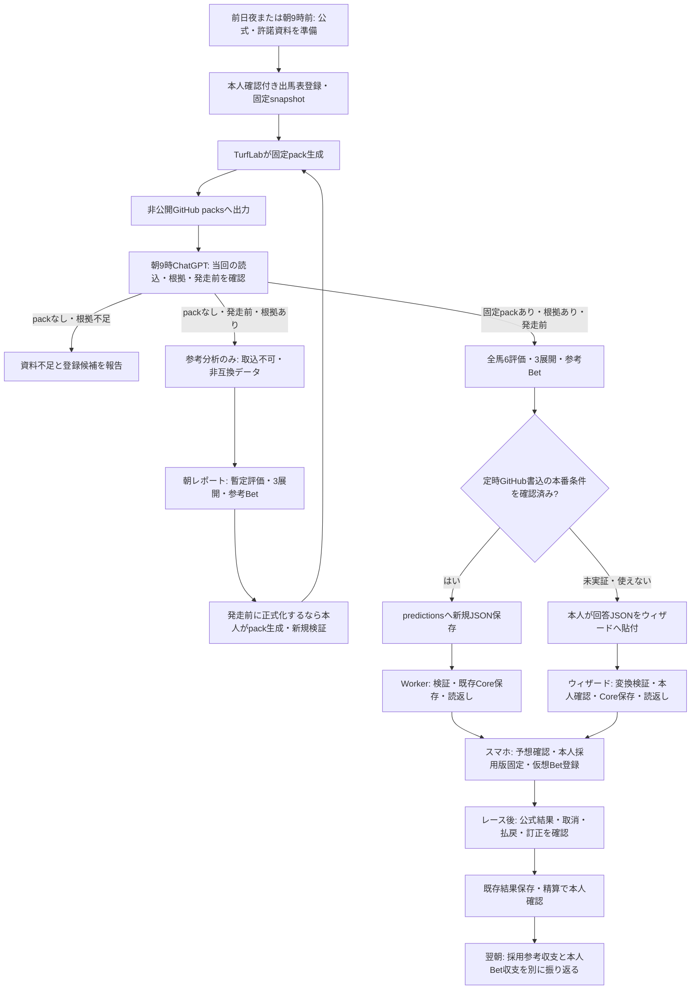

# TurfLabの日次運用：準備から翌日精算まで

2026-10-29。通常ChatGPT（Web/スマホ）の朝09:00タスクを対象とする。現行タスクの成果物を失わないよう、packなしの参考分析とpackありのCore正式受渡しを二系統に分離する。[置換用本文](../prompts/chatgpt-daily.md) と現行コードを照合した運用設計。未実装箇所があり、「スマホで確認・購入判断するだけ」の運用が完成したという意味ではない。

## 全体の流れ

手動経路とGitHub経路は同じ既存Coreを使う。**packなしの参考分析はCore経路ではなく、発走後にMorningへ遡及確定できない。** 参考分析の成果物は最大5Rの件数に含めるが、Core Complete件数へは含めない。ChatGPTは通常APIやDBを直接書き換えない。

## 担当・実装状態・不足する受入

| 段階                       | 現行の担当・経路                       | 状態と次の条件                                                   |
| -------------------------- | -------------------------------------- | ---------------------------------------------------------------- |
| 公式出馬表・当日開催の把握 | 本人が公式/許諾資料を確認して登録      | 手動。自動取得/ID照合は未実装。朝9時までの準備が必要             |
| 分析根拠                   | 過去走・脚質・騎手/コース実績等        | packは出馬表中心。詳細根拠とCoreのevidence対応を保つ拡張は未実装 |
| snapshot/pack/ID/hash固定  | 既存ウィザード/pack API                | 実装済み。実1Rの本人受入は未完了                                 |
| pack出力                   | Windows Worker + gh                    | 隔離実GitHub試験済み。通常ChatGPTで当回読めるかは別検証          |
| 朝9時分析・GitHub保存      | 通常ChatGPTの既存タスク                | packありは正式回答、packなしは暫定参考資料。定時読書き未実証・既定は手動受渡し |
| 予想検証・確定保存         | Workerまたはウィザード→Core            | 隔離試験済み。本人Betは生成しない                                |
| 本人採用・仮想購入         | スマホTurfLabで本人登録                | 既存機能。1R1,000円/JST日5,000円。iPhone実機受入は未完了         |
| 結果保存・訂正精算         | 既存 `/results` と結果別settle処理     | 既存機能。GitHub Bridgeは結果を自動受信しない                    |
| 前日記録を朝タスクへ渡す   | 採用版/本人Bet/訂正/精算のエクスポート | 日次専用の自動出力は未実装。旧Sheetsを現在の全件記録にしない     |
| reviews                    | 将来拡張用のフォルダ設計               | 自動取込・結果反映・精算の対象外                                 |

## 元の本文から変える点

- 「毎朝公式サイトからID付きJSONまで作る」から「TurfLabのpackと根拠があるRだけ正式取込候補にする」へ変更。packなしでも発走前・根拠ありの参考分析は継続し、Core非互換・未取込と明示。資料不足Rは登録候補として別扱い。
- オッズ/人気の使用を買い目・金額・期待値まで禁止。旧本文の「期待値/券種・金額の参考」は削除。
- 自由なウェブ追加情報で固定cutoffを上書きしない。変更があれば新snapshotが必要。資料不足を全馬50点等で埋めない。
- リポジトリに残る旧Sheets書込許可の指示を削除し、旧Sheetsは移行前履歴の読取専用に統一。Notionも書かない。
- `date|track|race_no` をBridge JSONへ追加しない。既存内部ID/hash/template/pathを使い、人間用レポートと機械用JSONを分離。
- GitHub Wrapperと、ウィザードに貼るanswerを区別。手動は回答→変換→本人確認→Core確定。チャット表示だけでファイル保存としない。
- 既存Morningがあれば自動v2作成で迂回しない。変更/Finalは本人確認付き別手順。
- 前日収支は採用参考と本人購入を分ける。旧Sheetsが読めても現在のTurfLabの採用/購入記録を読めたとは扱わない。分母不明や投資0円を架空の率で埋めない。
- 予想だけのBridgeへ結果JSONを混ぜない。結果保存/精算と振り返りは別段階。

## 日次レポートの二層契約

- **Reference（packなし）**: 公式情報の収集・出典と時点、全有効馬の評価可能な要素、スロー/平均/ハイ、参考Bet、未確認・欠測を表示する。`PREPARATION_NOT_IMPORTABLE`・未取込と明示する。登録ID、固定hash、Schemaを埋めたふりをしない。馬場等の不明を機械的な50点で埋めず、不足項目は未評価とする。完成した分析でもMorning確定済み・Core Completeとは呼ばない。
- **Core candidate（packあり）**: ウィザード発行の既存pack/answer_schema/情報締切を厳守し、全有効馬の6項目・3展開を満たす1R回答を作る。GitHubへ保存しただけではCore未完了。Workerまたは本人のCore検証/locked読返しに成功して初めて完了扱い。
- **両経路の合計は1日最大5R**。朝レポートには`reference_count`と`core_candidate_count`を区別して記す（レポート項目であり既存JSON Schemaには追加しない）。
- **過去分**: 前日の仮想提案だけの事後的な試算は、発走前に作成された証拠がある場合のみ「参考提案の事後検算」と記す。保存済みMorningの正式ROI、採用参考収支、本人Bet収支とは別母集団で示す。公式結果が未保存なら結果照合済みと精算完了を分ける。

## 実運用の開始条件と優先順

1. packなしの朝も公式出馬表・戦績等の調査と参考レポートを提供する。そのうえで、まず1Rの正式な入力・根拠をそろえる。現行 `inputPack` のevidenceは本人確認した出馬表1件で「過去走の根拠ではない」と明記される。別資料の能力実績をこのevidenceで確認済みに見せない。根拠を固定入力に組み込む設計・時点/許諾/hash/馬ID参照の実装と受入が次の開発対象。
2. 通常ChatGPTで当日packの読込を確認し、その後同じタスク環境・接続で1回の定時読込/新規書込を試験branchに限定して実証する。実際の既存タスク本文は今回まだ変更していない。
3. 本人確認済み発走前実1Rで、実回答→Core読返し→スマホ本人採用/Betまで確認。次に最大5R・途中失敗・旧予想保持を受け入れる。
4. 前日の採用版/本人Bet/精算を朝タスクへ渡す読取専用日次エクスポートを別途実装する。キー等を除き、as_of・対象日・採用ID・訂正/取消/settlement状態・網羅範囲を含める。全ロック版の推奨を本人購入へ変換しない。
5. 公式結果の自動受信・既存saveResult/settle再利用は別の小さな変更として実装・受入する。旧Sheetsや新DBへの直接書込で迂回しない。

1・2は独立して準備できる。pack未準備日も参考レポートは継続する。ただし新規Core確定は別条件。定時GitHub書込が成功しても、入力と根拠の準備が手動なら完全自動化ではない。「スマホだけ」に不足するのは、主に許諾済み入力/根拠の準備、通常ChatGPTの定時受渡し実証、結果/日次記録の受渡し。

## GitHubが定時実行で使えない場合

最初の代替は現在の手動ウィザード。packを取り出し通常会話で分析し、返されたanswerを本人が貼る経路を維持する。

Drive JSON/既存Sheets受信は次の候補だが、同じ通常ChatGPTの定時実行で読書きできること、保存先/権限、受信アダプター、hash/Schema/Core再利用を別途確認する。旧Sheets/Notionの書込禁止を自動解除しない。代替同期が実装・受入済みとは扱わない。

## 検証の区別

- 指示文を編集したことはChatGPTの実タスク設定更新ではない。
- 定時書込成功と、資料充足・実予想品質・TurfLab取込・本人Bet登録は別。packなしの調査は「参考分析のみ」。
- PC停止中はローカル取込が進まない。GitHub保存後、起動時に受信できても、未完了Morningが発走後まで残った場合は新規確定を拒否する。
- GitHubだけを見る朝タスクはローカルCore状態を知れない。将来のreceipt出力を実装するまでは「取込状態未確認」が正しい報告。推測でcompleteとしない。
