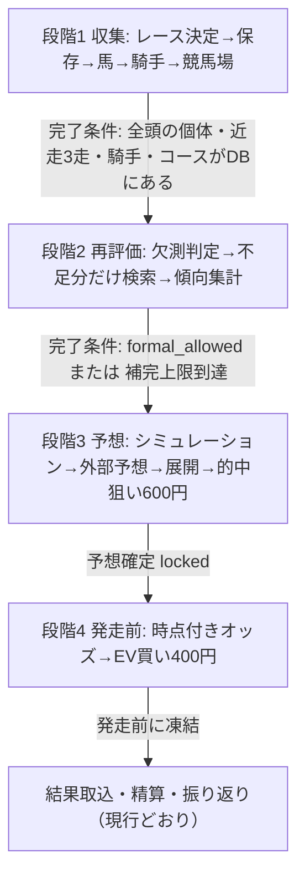

# TurfLab レースフロー v2（段階制）

2026-11-11 本人方針。現行の `scripts/local-prediction-worker.ts` は1回の `tick` の中で「調査→近走→馬場→予想→発走前再調査→仮想プラン」を条件分岐で順に流しており、**情報が揃ったかどうかを確認する区切りがない**。そのため欠測があると補完せずに暫定予想へ落ち、買い目は空のまま、発走前の単勝EVだけが動いている。v2では1レースを4つの段階に分け、段階ごとに「完了条件」を満たしてから次へ進む。

[標準フローv1（22ステップ対応表）](standard-race-flow-v1.md) の区分・決定事項（オッズは能力評価に使わない等）はそのまま引き継ぐ。

## 決定事項（2026-11-11）

1. **予算**：1R合計1,000円は継続。**的中狙い600円（段階3）＋発走前の期待値買い400円（段階4）に固定で分ける**。2つは別プランとして記録し、成績を別々に集計・比較する。
2. **対象R数**：段階2の補完検索で呼出しが増えるため、**1日の自動選定を最大5R→3Rに減らす**。CLI呼出し上限（1日24回）は変えない。
3. **CLIの使い分け（コスパ重視）**：段階1・2・4の調査系（出馬表・近走・騎手・補完検索・馬場・オッズ）は安いGemini 3.8 Flash、段階3の予想（評価・展開・買い目）だけCodexまたはClaude Code。振り分け自体は実装済み（`scripts/local-predictions.ts` の `--helper-model`、既定 `gemini-3.8-flash-medium`）。**呼出し上限は今は両者合算で24回/日なので、調査（Gemini）と予想（Codex/Claude）で別枠に分ける**。予想は1R1回（再予想を含め最大2回）を基本にし、高いモデルの呼出しを3R×2＝6回/日程度に抑える。
4. **保存単位**：馬・騎手・競馬場の調査結果は**個体単位のDB**（`horses` / `jockeys` / `performances` / `entity_features`）に貯める。保存済みの走・傾向は再検索せず、不足分だけ調べる。packは個体DBから組み立てる。

## 段階の全体像

各段階の状態はレースごとに `race_pipeline_runs` に記録し、Webの「ローカル自動予想」に「段階2：騎手の同場成績を補完中」のように表示する。1回の `tick` では1レースにつき1段階だけ進める（呼出しの偏りと15分タイムアウトを避ける）。

## 段階1 収集（情報をDBに揃えて一段落）

| 順 | 処理 | 保存先 | 現状 |
|---|---|---|---|
| 1 | 予想するレースを決める（最大3R/日） | `races` / `race_entries` / `race_snapshots` | ✅ research ジョブ（最大3R、`MAX_AUTO_RACES`） |
| 2 | 出馬表の全頭を固定 | snapshot | ✅ |
| 3 | 馬ごとに近走3走を調べて保存（**保存済みの走は飛ばす**） | `entity_features`（`horse-run-v1`） | ✅ 出典付きの走を馬ごとに保存（`workers/api/src/entity-memory.ts`）。保存済みの走は依頼から外し、全頭そろっていればCLIを呼ばない |
| 4 | 騎手ごとに同場・同コース成績を保存 | `entity_features`（`jockey-note-v1`） | ✅ 騎手リーディングのメモを騎手×競馬場で保存し14日間再利用。NAR CSV集計は従来どおり `research.local_stats` |
| 5 | 競馬場・コース諸元 | `tracks` / `course_layouts` | ✅ コース諸元マスタ（b58e99e） |

**完了条件**：全有効馬について個体ID・近走（最大3走、無ければ「出走歴なし」と明記）・騎手の成績行がDBにある。満たしたらpackを個体DBから組み立てて段階2へ。

**2026-11-13 改訂（前走DB化）**：近走は `entity_features` ではなく `performances`（1頭×1開催日＝1行、項目別の出典付き）に保存する。順序は ①保存済みの走 → ②NAR CSV（本人が保存したもの）→ ③CLI検索（不足項目だけ）。「3走ある」だけでは完了とせず、必須13項目の値と出典がそろった走が3走あることを完了条件にする（`run-coverage-v1`、Webに項目別充足率を表示）。騎手は `jockey-stats-v1` を標本数付きで時点保存する。詳細は PROGRESS.md 2026-11-13。

## 段階2 再評価（足りない情報を検索）

| 順 | 処理 | 現状 |
|---|---|---|
| 1 | `evidence-coverage.ts` で6評価ごとに observed / weak / missing を判定 | ✅ |
| 2 | **missing / weak の項目だけを対象に補完検索**（馬・騎手単位で1回にまとめる） | ✅ `fillGaps`：欠測（とcourse以外のweak）の項目だけを1回の検索で依頼。1Rあたり最大2回（`MAX_FILL_ROUNDS`） |
| 3 | 馬の傾向（距離・馬場・脚質）、騎手の傾向、競馬場の傾向（枠・脚質）、直近の傾向（当日の確定済みR）を集計 | ✅ `/local-predictions/trends`（`workers/api/src/race-trends.ts`）：馬の距離±200m・同馬場の相対着順、前半位置、同日同場の確定Rの3着内の枠。標本数付きで予想に渡す。騎手は `local_stats` |
| 4 | 補完結果を個体DBに保存し、新しいpackを作る | ✅ 新しいpackを作るたびに個体DBへ保存（冪等） |

**完了条件**：`formal_allowed = true`、または1Rあたりの補完呼出し上限（2回）に達した。上限到達時は欠測を理由付きで記録して段階3へ進む（正式にせず暫定予想。捏造で埋めない方針は維持）。

## 段階3 予想（的中狙い・オッズ無視）

| 順 | 処理 | 現状 |
|---|---|---|
| 1 | 数値シミュレーション（`segment-mc-v1`）を実行し、勝率・連対率・3着内率と組合せ確率を出す。未校正なら明示 | ✅ `pl-mc-v1`（`scripts/bet-plans.ts`）：6評価から出した勝率でPlackett-LuceのMCを2万回（シード固定）。勝率・連対率・3着内率とワイド・馬連・馬単・三連複の確率。30R未満は「未校正」と記録。`segment-mc-v1` は能力入力が揃うまで使わない |
| 2 | 他の予想サイトを見る（公開・閲覧時刻と出典を記録、印だけで点を上げない） | ✅ 補助モデルで1Rにつき1回、独立した最大5件の印・根拠・公開/閲覧時刻を `exchange/external/` に保存（Core外）。予想プロンプトには「固定packで裏付けた事実だけで評価を変える」条件付きで渡す |
| 3 | 展開予想（slow/middle/high＋各コーナーの想定順位） | ✅ 文章／数値順位は任意項目として追加予定 |
| 4 | **的中狙いの買い目 600円**：上位評価馬から三連複・ワイド・馬連・馬単を組む。**オッズは見ない** | ✅ `hitPlan`：ワイド2点・馬連1点・馬単1点・三連複2点（各100円、計600円）をMC確率の高い順に。`plans/<日>/<R>-hit.json` に予想直後に固定、`odds_used:false` |
| 5 | locked で凍結 | ✅ |

的中狙いの組み方（初期案、要調整）：軸1〜2頭＋相手3〜4頭。例：ワイド軸流し3点×100円、馬連2点×100円、三連複軸1頭流し・相手3頭1点×100円 … 合計600円以内。券種と点数は確率モデルの出力（組合せの的中確率）が上位のものから選ぶ。確率が出せない間は順位ベースの固定テンプレートで組み、「順位ベース」と記録する。

## 段階4 発走前（期待値買い）

| 順 | 処理 | 現状 |
|---|---|---|
| 1 | 発走60〜10分前に時点付きオッズを取得（単勝に加え、可能なら馬連・ワイド等） | ✅ 単勝全頭＋MC上位の組合せ（ワイド4・馬連3・馬単3・三連複3）のオッズを依頼 |
| 2 | 段階3の確率 × オッズで期待値を計算し、**EVの高い買い目に400円** | ✅ `evPlan`（`ev-plan-v2`）：EV1.1以上（確率は単勝5%・組合せ2%以上）を高い順に最大4点×100円 |
| 3 | EV基準を満たす買い目が無ければ見送りを記録（400円は使わない） | ✅ 見送り記録あり |
| 4 | 発走前に凍結 | ✅ |

オッズは段階4の期待値計算だけに使い、段階3の評価・印・的中狙いの買い目には入れない（v1決定事項1を維持）。

**2026-11-13 改訂**：組合せ確率は `pl-mc-v1`（MC2万回）から厳密計算 `pl-exact-v1` に変更（乱数で上位買い目が入れ替わる問題の解消）。段階4では400円枠に加えて、市場の勝率を基準に6評価の上乗せ分だけを足す「市場基準レーン」を `plans/<日>/<R>-evm.json` に並べて記録する。時系列検証で市場を上回る証拠が出るまで買わない。400円枠の本線をどちらにするかは本人が決める。根拠と実測は [評価方法と期待値の扱い](evaluation-method.md)。

## 実装の順番

| # | 作業 | 主な変更箇所 | 依存 |
|---|---|---|---|
| 1 | レースごとの段階状態（stage1〜4）を持たせ、`tick` を段階ディスパッチに分割。自動選定を3Rに。呼出し上限を調査（Gemini）と予想（Codex/Claude）で別枠化 | `scripts/local-prediction-worker.ts`（`generate` の上限計算）、`race_pipeline_runs` | なし |
| 2 | 近走・騎手成績を個体DBへ保存し、保存済み分を検索から除外 | `scripts/local-history-research.ts`、`workers/api/src/race-pipeline.ts` | 1 |
| 3 | 段階2：欠測項目だけの補完検索と傾向集計 | worker、`scripts/evidence-coverage.ts` | 2 |
| 4 | 段階3：的中狙い600円の買い目生成（まず順位ベース） | `workers/api/src/betting.ts`、`scripts/lab-learning.ts` | 1 |
| 5 | 段階3：外部予想の比較をCLIに追加 | worker（調査プロンプト・保存形式） | 1 |
| 6 | 段階4：EV買いを400円枠に変更、券種を拡張 | `scripts/lab-learning.ts`、prerace ジョブ | 4 |
| 7 | 段階3：数値MCをCLIで実行し組合せ確率を出す | `segment-mc-v1`、#17 | 2, 3 |

**作業1〜7は2026-11-11に実装済み**（作業1の詳細）：自動選定は最大3R（`MAX_AUTO_RACES`）。呼出し上限は `callBucket` で調査24回／予想6回／結果・レビュー10回に分離。レースごとの段階は `status.json` の `race_stages` に出し、Webの「ローカル自動予想」に表示する。近走の調査や馬場確認でCLIを呼んだレースは、その周期では予想に進まず次の周期（5分後）に回す。例外として発走前の再調査で入力が変わった未確定レースは、時間が無いため同じ周期で再予想する。`race_pipeline_runs` への記録は未対応（status.jsonのみ）。

1と4は独立に着手できる。まず1→2で「DBに揃えて一段落」を実現し、次に4と6で予算の2枠を動かす。

### 1レースの進み方（実装後）

5分ごとの周期で、CLIを呼んだレースはその周期では次に進まない。目安は次のとおり。

1. 出馬表調査（自動選定、3時間ごと）→ 近走・騎手の調査（不足分だけ。全頭保存済みならCLIなし）
2. 欠測の補完検索（最大2回）→ 傾向集計（コードのみ）
3. 外部予想の確認（1回）→ 予想（Codex/Claude）→ 的中狙い600円を固定
4. 発走60〜10分前：馬場・当日傾向・オッズの確認 → 期待値買い400円を固定（無ければ見送り）

1日の調査枠（24回）の見込み：出馬表4回＋1Rあたり最大6回（近走1・補完2・外部1・馬場1・発走前1）×3R＝22回。予想枠（6回）は3R×（予想＋発走前の再予想）。成績はWebの「学習の記録」で的中狙い600円と期待値買い400円を別々に表示する。どちらも仮想で、実馬券は買わない。
